<div align="center">
  

  <br />

  <p>
    <a href="https://mammadow.github.io/">Portfolio &amp; CV</a> &nbsp;&middot;&nbsp;
    <a href="mailto:mammadow.elnur@gmail.com">mammadow.elnur@gmail.com</a> &nbsp;&middot;&nbsp;
    <a href="https://www.linkedin.com/in/elnurmammadovv/">LinkedIn</a> &nbsp;&middot;&nbsp;
    <a href="https://www.kaggle.com/mammadovelnur">Kaggle</a>
  </p>
</div>

---

I approach engineering as a single continuous problem space across **software, hardware, mechanics, and electronics**. Rather than confining my work to a single role or abstraction layer, I focus on understanding systems from first principles—from physical circuits, mechanics, and embedded firmware up to algorithmic design and machine intelligence.

My work spans systems software, machine learning, competitive programming, and autonomous robotics, building systems designed to hold up under real-world physical and computational constraints.

---

### Engineering Scope

```text
Robotics & Hardware   :: Cross-disciplinary design (software, hardware, mechanics & electronics), autonomous navigation, sensor integration, UAV & combat robotics
Systems & Embedded    :: C/C++, HAL & OS internals, microcontroller & EC interfaces, Win32 telemetry, systems software architecture
Machine Intelligence  :: PyTorch, TensorFlow, sequence & vision models (Transformers, LSTM, CNN), ONNX real-time inference
Algorithms & Core CS  :: Competitive programming (ICPC), graph theory, dynamic programming, state search, Python, SQL, Docker
```

---

### Experience & Background

* **HAL Team Lead & Systems Software Engineer** at **AZEROS** — Leading Hardware Abstraction Layer (HAL) architecture, systems software, and embedded integration.
* **Machine Learning Engineer** at **Chevir** ([ChevirApp](https://github.com/Chevir-App-Development-Team/chevir-app-vers-1.0)) — Built the real-time Azerbaijani Sign Language recognition and translation pipeline (depthwise Conv1D + ECA + Transformer ONNX inference, 43.9 GB AzSLD corpus).
* **Education & Research** — B.Sc. Computer Engineering at **Qarabağ University** (3rd year, Fall-3 GPA: 97.40/100) &middot; Machine Learning Track at **Holberton School** (100% Scholarship) &middot; Published research on sequence modeling (*A Comparative Analysis of LSTM and Transformers for Sign Language Recognition*) and AI-era software engineering (*Transformation of Programming in the Age of AI*).

---

### Selected Competitions & Recognition

* **TEKNOFEST (NSosyal İnovasyon Yarışması)** — 3rd Place (*Team Chevir — ChevirApp*)
* **Holberton Kaggle ML3 Competitions** — **1st Place** (*HLBN Plants* `1/18`: `0.9565` private / `0.9947` public F1 via 5-fold EfficientNetV2-S + 3&times;TTA; *HLBT Housing Prices*: stacked CatBoost/LightGBM/XGBoost + linear ensemble) &middot; **Top 2 / 46** (*HLBT TED*, `0.03570` MSLE via LightGBM/TabPFN calibration)
* **Turkic World UAV Competition** — 3rd Place (*Gebze Technical University · Organization of Turkic States*)
* **2025 ICPC Northern Eurasia Finals** — Honorable Mention (*Team QU 1*)
* **VIII Republic Robot Olympiad (WRO Future Engineers)** — 3rd Place ([NEDrobotics](https://github.com/NEDrobotics/WRO2025-NED) — *cross-disciplinary engineering: software, hardware, mechanics &amp; electronics*)
* **Technoxian World Robot Championship (BotsCombat 15 kg)** — 3rd Place
* **Sumgayit Cup (Inter-University Programming Contest)** — 3rd Place (*Apr 2025*) &middot; Participant (*2nd Cup, Feb 2026*)
* **FIRST LEGO League Challenge (Robot Design)** &amp; **Lutfi Zadeh Logic Olympiad** — 1st Place

---

### Featured Engineering Repositories

* **[chevir-app-vers-1.0](https://github.com/Chevir-App-Development-Team/chevir-app-vers-1.0)** — Real-time Azerbaijani Sign Language (AzSL) bi-directional recognition &amp; VRM 3D synthesis (TEKNOFEST 2026 3rd Place)
* **[NEDrobotics/WRO2025-NED](https://github.com/NEDrobotics/WRO2025-NED)** — Autonomous vision-driven vehicle for WRO Future Engineers (3rd Place)
* **[win-anomaly-monitor](https://github.com/mammadow/win-anomaly-monitor)** — Adaptive ML-based Windows telemetry monitor and kernel forensics tool for anomaly detection and root-cause diagnostics
* **[predator-phn16-71-mode-led](https://github.com/mammadow/predator-phn16-71-mode-led)** — Reverse-engineering notes and cross-platform EC control tool for Acer Predator Helios Neo 16 Mode-button LED and RGB
* **[keychron-battery-tray](https://github.com/mammadow/keychron-battery-tray)** — Lightweight native C17/Win32 Windows system tray battery indicator &amp; CLI for Keychron wireless mice
* **[mangala](https://github.com/mammadow/mangala)** ([Live Demo](https://mammadow.github.io/mangala/) &middot; [PyPI `mangala-game`](https://pypi.org/project/mangala-game/)) — Authentic Turkish Mangala engine, tournament alpha-beta AI, PWA web UI, CLI, and desktop GUI
* **[hopfield](https://github.com/mammadow/hopfield)** ([Live Demo](https://mammadow.github.io/hopfield/)) — Interactive Hopfield neural network local-search / state-flipping associative memory analyzer
