<div align="center">
  

  <br />

  <p>
    <a href="mailto:mammadow.elnur@gmail.com">mammadow.elnur@gmail.com</a> &nbsp;&middot;&nbsp;
    <a href="https://www.linkedin.com/in/elnurmammadovv/">LinkedIn</a> &nbsp;&middot;&nbsp;
    <a href="https://www.kaggle.com/mammadovelnur">Kaggle</a>
  </p>
</div>

---

I approach engineering as a single continuous problem space across **software, hardware, mechanics, and electronics**. Rather than confining my work to a single role or abstraction layer, I focus on understanding systems from first principles—from physical circuits, mechanics, and embedded firmware up to algorithmic design and machine intelligence.

My work spans systems software, machine learning, competitive programming, and autonomous robotics, building systems designed to hold up under real-world physical and computational constraints.

---

### Engineering Scope

```text
Robotics & Hardware   :: Cross-disciplinary design (software, hardware, mechanics & electronics), autonomous navigation, sensor integration, mobile & combat robotics
Systems & Embedded    :: C/C++, microcontroller & EC interfaces, Linux & OS internals, systems software architecture
Machine Intelligence  :: PyTorch, TensorFlow, sequence & vision models (Transformers, LSTM, CNN), real-time inference
Algorithms & Core CS  :: Competitive programming (ICPC), graph theory, dynamic programming, state search, Python, SQL, Docker
```

---

### Experience & Background

* **Systems Software Engineer** at **Azeros** — Working on systems software and embedded integration.
* **Machine Learning Engineer** at **Chevir** — Developing real-time sign language recognition and translation models.
* **Education & Research** — Computer Engineering at **Qarabağ University** &middot; Machine Learning at **Holberton School** (100% Scholarship) &middot; Published research on sequence modeling (*Comparative Analysis of LSTM and Transformers for Sign Language Recognition*) and AI-era software engineering.

---

### Selected Competitions & Recognition

* **TEKNOFEST (NSosyal İnovasyon Yarışması)** — 3rd Place (*ChevirApp*)
* **World Robot Olympiad (WRO) — Future Engineers** — 3rd Place ([NEDrobotics](https://github.com/NEDrobotics/WRO2025-NED) — *cross-disciplinary engineering: software, hardware, mechanics & electronics*)
* **Turkic World UAV Competition** — 3rd Place
* **Technoxian World Robot Championship (BotsCombat 15 kg)** — 3rd Place
* **FIRST LEGO League Challenge (Robot Design)** & **Lutfi Zadeh Logic Olympiad** — 1st Place
* **ICPC Northern Eurasia Finals** — Honorable Mention
* **Sumgayit Cup (Inter-University Programming Contest)** — Participant
